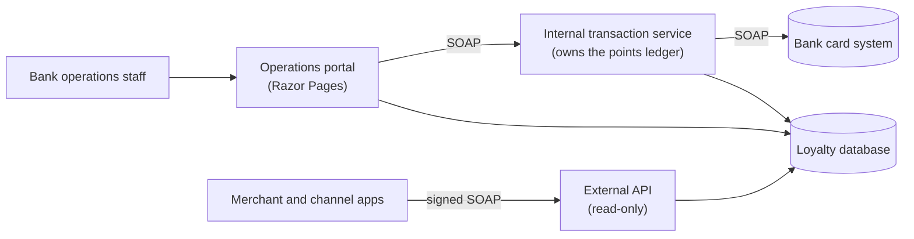

# Master Loyalty Point System 2.0

**An enterprise loyalty platform where cardholders earn reward points on their cards, and bank staff look up, redeem, transfer and award points, configure earning rules and report on the portfolio. Re-platformed from a legacy system to a three-tier .NET 10 solution.**

> **About this repository**
> This project was built in a professional setting and its source code is the property of my employer. This repository is a **portfolio write-up only**: it contains no source code, no client data, no interface definitions and no internal system details. Names, figures and workflows are described at a general level.

---

## Overview

A bank rewards its cardholders with points on debit and credit card spending. This platform is what the bank's operations, marketing and security teams use to manage that programme: checking balances, redeeming points at partner merchants, moving points between cardholders, awarding campaign points in bulk, configuring how points are earned, and reporting on the whole portfolio.

The original system was built on ASP.NET Web Forms with legacy web services. I worked on **re-platforming it onto .NET 10** as three deployable components while keeping existing merchant terminals and channel integrations working **without any change on their side**.

## My Role

- Re-platformed the operations portal and both web services onto .NET 10 with backward-compatible service contracts.
- Built the points transaction flows: redemption, transfer and cash-back through the bank's card system.
- Designed and built the bulk campaign upload subsystem.
- Implemented the security layer, including a forced password change on first login.
- Built the reporting and configuration screens, and wrote the database deployment scripts.

## Key Features

**Loyalty operations**
- **Points lookup:** a cardholder's available balance and a paged, filterable transaction ledger, exportable to CSV, Excel and PDF.
- **Redemption at merchants:** calculates the maximum redeemable amount from the merchant's earn/burn ratio, enforces it server-side, and can chain a cash-back transaction through the bank's card system.
- **Point transfer** between cardholders, with validation of both cards and the source balance.
- **Bulk campaign awards:** upload a file of campaign points, validate the file and every record, review the results, then commit all-or-nothing or cancel.
- **Upload history** with search, record-level drill-down and exact re-download of any processed file.
- **End-of-day processing** trigger and status.

**Configuration**
- One maintenance screen for channels, card ranges, transaction types, merchant categories, merchants and point ratios, each with add, inline edit, delete and export.

**Reporting**
- Allocation, redemption and portfolio reports with date-range guard rails, server-side paging, and CSV, Excel and PDF export.

**Security and administration**
- Account lockout, password expiry, password reuse prevention and a policy validator.
- **Forced password change on first login** and after an administrator reset.
- Role-based authorization driven from the database, with user management and activity logging.

## Tech Stack

| Area | Technology |
|---|---|
| Runtime | .NET 10, C# |
| Operations portal | ASP.NET Core Razor Pages, cookie authentication, server sessions |
| Services | SOAP services on ASP.NET Core (SoapCore), WCF client for the card system |
| Database | Microsoft SQL Server, stored-procedure based data access (no ORM) |
| Exports | Excel and PDF generation libraries, CSV |
| Logging | Serilog with rolling files |
| Front end | Bootstrap 5, jQuery, jQuery Validation (self-hosted, no CDN) |

## Architecture

- **Three deployable units, one database.** The portal reads configuration directly but routes every point-moving operation through the internal service, so the ledger has a single writer path.
- **Minimal public surface.** The partner-facing service exposes only a read operation, protected by signed requests.
- **Layered portal:** pages, business services, a data-access layer, and a small composable validation-rule engine.

## Engineering Highlights

- **Non-breaking migration.** Service contracts, response formats and request-signing were kept fully compatible, so existing point-of-sale terminals and partner integrations continued working unchanged. Legacy page addresses redirect to new routes.
- **All-or-nothing bulk processing.** Campaign files go through structural and per-record validation, a reviewable staging step, and a single database transaction on commit, so a bad record can never half-apply a file.
- **Exact file reconstruction.** The original records are retained, so any processed file can be re-downloaded exactly as uploaded.
- **Unbypassable first-login gate.** Users with an administrator-issued password are diverted to a password-change step before they are ever signed in, using short-lived hand-off tokens, so the step cannot be skipped by navigating elsewhere. Write ordering was chosen so that a partial failure can never leave a temporary password usable with the gate switched off.
- **One source of truth for access.** The navigation menu and the server-side page guard are generated by the same function from the same permission data, so a user can never see a link they cannot open, or open a page they were not meant to see.
- **Safe, repeatable deployments.** Database scripts are idempotent, paired with rollback scripts, and verify their own results, written to work on an older SQL Server version.
- **Data hygiene.** Card numbers are masked in every log line.

## Scale

- Three .NET projects, more than 15 portal screens and close to 20,000 lines of hand-written C#, Razor and SQL.

## Skills Demonstrated

`C#` · `.NET 10` · `ASP.NET Core Razor Pages` · `SOAP / SoapCore / WCF` · `Legacy migration` · `SQL Server` · `Stored procedures` · `Transactions` · `File processing and validation` · `Authentication and authorization` · `Secure password flows` · `Reporting and export` · `Serilog` · `Loyalty and payments domain`

---

**Sarim Nadeem** · MSc Computer Science · [LinkedIn](https://www.linkedin.com/in/msarimnadeem) · [GitHub](https://github.com/Sarim375)

*Source code is proprietary and not available. Happy to discuss the design and engineering decisions in an interview.*
